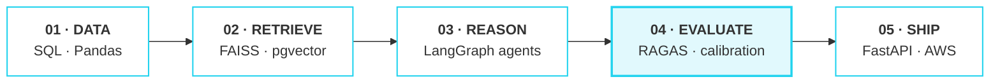
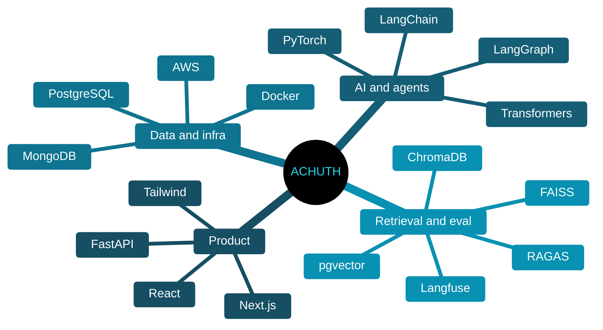

<div align="center">


<a href="https://achuthfolio.vercel.app/"></a>
<a href="https://www.linkedin.com/in/achuth-g-69104a251"></a>
<a href="mailto:achuthganesh09@gmail.com"></a>

</div>

&nbsp;

```yaml
whoami:
  role:       Data Science @ AB InBev GCC
  education:  B.Tech CSE, VIT Chennai
  focus:      [agentic systems, retrieval, LLM evaluation]
  approach:   understand why it works, then make it work at scale
  status:     open to collaborations
```

&nbsp;

## ◆ How I build



&nbsp;

## ◆ Selected work

| | Project | What it does | Stack |
|:-:|:--|:--|:--|
| 01 | **[Symptom Checker](https://github.com/Achuth-0908/healthcare_symptom_checker-backend)** | RAG chat over medical sources, answered by Gemini or Groq | FastAPI · ChromaDB · Next.js |
| 02 | **[JobIntel AI](https://github.com/Achuth-0908/jobintel-ai-backend)** | Scores résumé-to-job fit and extracts the skills behind it | Flask · NLP · TypeScript |
| 03 | **[AnomalyGuard](https://anomalyguard-ai.streamlit.app/)** | Interactive anomaly detection with a live demo | scikit-learn · Streamlit |
| 04 | **[Shopify Analytics](https://github.com/Achuth-0908/shopify_analytics_backend)** | Multi-tenant ingestion and metrics dashboard | Express · PostgreSQL · Next.js |

&nbsp;

## ◆ Toolkit



<div align="center">

</div>

&nbsp;

## ◆ Activity

<div align="center">
<picture>
  <source media="(prefers-color-scheme: dark)" srcset="https://github-profile-summary-cards.vercel.app/api/cards/profile-details?username=Achuth-0908&theme=github_dark">
  
</picture>
<picture>
  <source media="(prefers-color-scheme: dark)" srcset="https://github-profile-summary-cards.vercel.app/api/cards/productive-time?username=Achuth-0908&theme=github_dark&utcOffset=5.5">
  
</picture>
<picture>
  <source media="(prefers-color-scheme: dark)" srcset="https://github-profile-summary-cards.vercel.app/api/cards/most-commit-language?username=Achuth-0908&theme=github_dark">
  
</picture>
</div>

&nbsp;

<div align="center"><sub><i>"The purpose of computing is insight, not numbers."</i> · Richard Hamming</sub></div>
